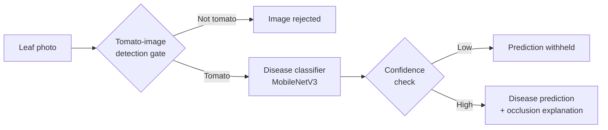

# TomatoXAI

**Offline, explainable tomato leaf disease detection on Android.**

TomatoXAI is a final-year project: an Android app that identifies tomato leaf diseases entirely on the device, with no internet connection. It is built to be cautious and transparent. It checks that the photo is actually a tomato leaf, holds back predictions it is not confident about, and shows which parts of the leaf drove the result.

## Features

- **Fully offline:** the machine learning models run on-device using TensorFlow Lite, so the app works in the field without connectivity.
- **Two-stage pipeline:** a tomato-image detection gate filters out unrelated images before the disease classifier runs.
- **Reliable predictions:** confidence-based selective prediction and model calibration reduce the risk of unreliable results.
- **Explainable AI:** occlusion-based analysis gives a visual explanation of each prediction.
- **Mobile-optimised:** the models are compressed with TensorFlow Lite quantisation for efficient on-device inference.

## How It Works



## Results

Selected evaluation results:

| Component | Metric | Result |
|---|---|---|
| Tomato-image detection gate | Accuracy | **98.06%** |
| Disease classification | Accuracy | **86.33%** |
| Disease classification | Macro-F1 | **0.8382** |
| Out-of-distribution rejection | Share of evaluated test images rejected | **68.8%** |

Models were also evaluated for inference latency and explainability, in addition to the metrics above.

## Tech Stack

| Area | Tools |
|---|---|
| Mobile app | Flutter |
| Model training and evaluation | Python |
| Model architecture | MobileNetV3 |
| On-device inference | TensorFlow Lite (quantised) |

## Getting Started

**Prerequisites:** [Flutter SDK](https://docs.flutter.dev/get-started/install) and an Android device or emulator.

```bash
git clone <your-repository-url>
cd <your-repository-folder>
flutter pub get
flutter run
```

## Project Background

Developed as a final-year project on practical, trustworthy AI for agriculture: models that run offline, say when they are unsure, and show their reasoning.# tomato_xai_mvp_fixed

A new Flutter project.

## Getting Started

This project is a starting point for a Flutter application.

A few resources to get you started if this is your first Flutter project:

- [Lab: Write your first Flutter app](https://docs.flutter.dev/get-started/codelab)
- [Cookbook: Useful Flutter samples](https://docs.flutter.dev/cookbook)

For help getting started with Flutter development, view the
[online documentation](https://docs.flutter.dev/), which offers tutorials,
samples, guidance on mobile development, and a full API reference.
